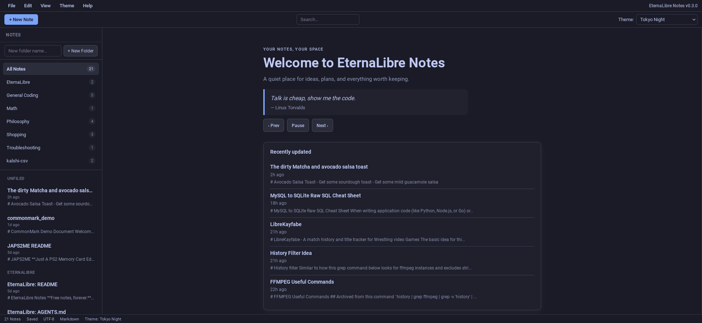

# EternaLibre Notes

**Free notes, forever.**



*EternaLibre Notes running in Firefox ESR 140 on Debian 13.*

A server-side rendered (SSR) Markdown notes application written in Rust.

EternaLibre Notes combines **GNU software freedom** (GPL v3.0-or-later) with the
fluid elegance of Apple Notes and the predictable utility of classic desktop
GUI applications: a menu bar, split-pane editor, and file-based note storage.

It is a toolkit for making a **private notes cloud**. You run the server
yourself, on your own hardware, and notes stay in local Markdown files. The
server binds to all interfaces by default, so you can reach your notes from a
phone or another machine on your network, protected by a TOTP code from your
authenticator app. There is no telemetry or account service. Optional weather
lookup sends the location you configure to wttr.in; leave it unset to keep the
app from making that request.

## What's new in 0.3.0

- **Welcome dashboard** — recent notes and an optional local weather card fill the editor when no note is open
- **Private-by-default weather** — configure a location in the app; it is stored with your notes and sent to wttr.in only to retrieve weather
- **Celsius/Fahrenheit choice** — the weather table keeps both scales and switches without refetching
- **Welcome quotes** — save quote/author pairs that rotate beneath the welcome message
- **Mobile weather page** — `View → Weather` opens a mobile-first weather screen on phones
- **Mobile welcome page** — `View → Welcome` opens a simplified header/quotes/recent-notes screen on phones
- **Quieter welcome state** — with nothing open the empty preview pane, tab, and toggle are omitted
- **Theme changes keep your place** — changing themes while editing returns to the open note

## What's new in 0.2.1

- **Collapsible folder navigation** — a pull-tab button on mobile and a `View → Hide/Show Folder Nav` toggle at any width let you collapse the folder list to give the note list more room
- **Independent mobile scrolling** — the folder nav and note list each scroll within their own bounded area on phones, instead of sharing one scroll position
- **Save Note moved** — the action now lives in the `File` menu alongside `New Note`, rather than under `Edit`
- **Folder-nav state persists** — hiding the folder nav saves the preference to browser storage and switches the sidebar to All Notes without navigating away from an open note, so unsaved edits survive
- **Delete confirmation** — deleting a note now asks you to confirm, showing the note's folder and title so you know exactly what you are about to remove

## What's new in 0.2

- **Virtual folders** — organize notes into folders without creating real directories. A folder is encoded as a `[Folder]uuid.md` filename prefix, so a single notes directory can hold many of them
- **Move notes between folders** — drag a note onto a folder in the sidebar, use `File → Move to Folder…`, or use the Move control in the editor on a phone
- **Re-filing is a rename** — `[Work]uuid.md` becomes `[Home]uuid.md`. The note's id never changes, so links to it keep working, and its modified time is not bumped
- **Long-press drag on touch** — the re-file gesture on a phone
- **Quieter folder counts** — badges show across every folder in the All Notes view, and only on the folder you are inside otherwise
- **Pinned folder list** — folders stay visible and droppable however long the note list grows

## Features

- **TOTP-locked by default** — authenticator app required on first launch and after every restart
- **Server-side rendered** with Axum and Maud — fast, type-safe HTML templates
- **Uses a small amount of JavaScript** — note editing, search, create/delete, and the login form are plain HTML; the menus, mobile tabs, live preview, and drag-and-drop re-filing are the JS-dependent parts. With JavaScript disabled, a `<noscript>` toolbar fallback keeps `New Note` and `Delete` available because the `File` menu cannot open
- **Alpine.js enhancements** — live Markdown preview, instant search, keyboard shortcuts
- **File-based storage** — notes are persisted as Markdown files in `notes/`
- **Virtual folders** — organize notes into folders without real directories; folders are encoded as `[Folder]uuid.md` filename prefixes
- **Move notes between folders** — drag a note onto a folder, use `File → Move to Folder…`, or the Move control in the editor on a phone
- **One-row folder picker** — the sidebar shows the current folder; the folder list opens on demand and automatically while dragging, so it stays droppable however long the note list grows
- **Per-note exports** — download Markdown or self-contained themed HTML, or print/save the themed note as PDF
- **44 built-in themes** — including KDE Breeze, Blueberry Professional, Evangelion-inspired units, classic desktop homages, distro-inspired palettes, warm neutrals, and more
- **Markdown extras** — tables, tasklists, strikethrough, and footnotes via `pulldown-cmark`
- **Syntax highlighting** — code blocks are highlighted using the current theme's ANSI palette via `syntect`
- **Mobile responsive** — collapses to a Notes/Write/Preview tab layout on phones, with 44px touch targets
- **Optional weather** — server-side wttr.in lookup with a Celsius/Fahrenheit choice, a current-plus-forecast table, caching, and a graceful offline fallback
- **Welcome quotes** — locally stored quotes rotate under the welcome message with pause and reduced-motion support
- **Mobile weather page** — `View → Weather` offers a mobile-first weather view on phones

## Quick Start

```bash
# Build and run (listens on 0.0.0.0:3000 by default)
cargo run

# Use a custom host/port
cargo run -- --host 127.0.0.1 --port 8080

# Serve behind a reverse proxy at a subdirectory
cargo run -- --base-path /el-notes
```

Then open http://127.0.0.1:3000 (or your chosen address).

Notes are stored in the `notes/` directory as `.md` files with YAML frontmatter. If you configure weather, its location is stored in `notes/.weather_location` and its unit in `notes/.weather_units` alongside the notes and both follow `--notes-dir`. Saved quotes live in `notes/.quotes.json`.

## Virtual Folders

Notes can be organized into virtual folders without creating real directories on disk. A folder is encoded as a filename prefix:

```
[Project Notes]550e8400-e29b-41d4-a716-446655440000.md
```

Root notes (no folder) keep the plain `uuid.md` format. Folders exist only when they contain at least one note — there is no separate folder metadata to manage.

**Creating a folder:** click `+ New Folder` in the sidebar, type a name, and the app creates a new note in that folder and opens it.

**Filtering:** choose a folder from the sidebar's folder picker to see only that folder's notes. Choose **All Notes** to see everything grouped by folder. When a folder is active, **File → New Note** creates notes in that folder.

**Moving a note between folders:** drag it from the sidebar onto a folder (the folder list opens while you drag), pick `File → Move to Folder…`, or use the Move control under the editor on a phone. Dropping a note on **All Notes** — or choosing **Unfiled** — takes it back out of its folder.

A move renames the file: `[Work]uuid.md` becomes `[Home]uuid.md`. The note's id is left untouched, so links to it keep working, and its modified time is not bumped, since re-filing is not an edit.

**Validation:** folder names reject path traversal (`..`), shell metacharacters (`;`, `|`, `&`, `$`, backtick, parens, angle brackets), control characters, leading dots, and names over 100 characters. Invalid names show a red flash message at the top of the page.

## Authentication

EternaLibre Notes is locked with TOTP. Because the server binds `0.0.0.0` by default, a code is required before any note can be read.

**First launch:** the server prints a QR code to your terminal and waits for a 6-digit code. Scan it with any TOTP authenticator (FreeOTP, Aegis, Bitwarden, Google Authenticator, …), or type the Base32 secret by hand if you would rather not scan. Only after a valid code is the secret committed to `.totp_secret` in the project root with mode `0600` — and only then does the port start listening.

Enrollment deliberately happens in the terminal rather than on a web page. There is no `/setup` route to reach: an HTTP-reachable setup endpoint would let anyone who can reach the port before you finish claim the device.

**Every launch after that:** you land on `/login` and need a current code. Sessions last one hour and live only in memory, so restarting the server invalidates them.

**Lost your authenticator?** Delete the secret in the data directory and restart:

```bash
rm .totp_secret
```

If you run under systemd, `.totp_secret` is in the unit's `WorkingDirectory`
(for the example unit, `target/release`), and the service's
`ConditionPathExists` makes it skip on the next start. Run the binary manually
once in that directory to re-enrol, then start the service again.

There is no recovery-code fallback by design — that file is the only thing holding the secret, and it stays on your machine.

## Behind a reverse proxy

To serve at a subdirectory, pass `--base-path`:

```bash
cargo run -- --base-path /el-notes
```

```apache
ProxyPass        /el-notes/  http://127.0.0.1:3000/  timeout=10
ProxyPassReverse /el-notes/  http://127.0.0.1:3000/
```

The proxy strips the prefix, so the app still sees ordinary paths and adds the prefix back when generating links, form actions, and redirects. The session cookie's `Path` is scoped to the prefix, so the token is not sent to sibling apps on the same host.

## Running as a systemd user service

The repository includes `eternalibre-notes.service`, a user-unit template. It
assumes the checkout is at `~/eternalibre-notes` and that the release binary and
the app's data both live in `target/release`; edit `WorkingDirectory` and
`ExecStart` if yours differ.

**1. Build the release binary:**

```bash
cargo build --release
```

**2. Enrol your authenticator once, manually.** First-run setup prints a QR code
and reads the code from stdin before the listener binds, so it cannot run under
systemd:

```bash
cd ~/eternalibre-notes/target/release
./eternalibre-notes --base-path /el-notes
```

Scan the QR or enter the Base32 secret, type the code, then stop the process.
Use your own `--base-path` if you serve behind a reverse-proxy subdirectory.

**3. Install and start the unit:**

```bash
mkdir -p ~/.config/systemd/user
cp eternalibre-notes.service ~/.config/systemd/user/
systemctl --user daemon-reload
systemctl --user enable --now eternalibre-notes
```

If an installed unit already exists, compare it first with
`systemctl --user cat eternalibre-notes.service`. In particular, keep any
existing `--base-path` value on `ExecStart`.

**4. Start at boot without logging in:**

```bash
sudo loginctl enable-linger "$USER"
```

**5. Check it:**

```bash
systemctl --user status eternalibre-notes
journalctl --user -u eternalibre-notes -f
```

> **`WorkingDirectory` is the data directory.** The app writes `notes/` and
> `.totp_secret` relative to it. The example uses `target/release` because that
> is where the release binary lives and, for an existing install, where the data
> already lives. **Do not run `cargo clean` against that tree** unless you have
> backed up or moved those files first. For a new install, point
> `WorkingDirectory` at a dedicated persistent directory instead.

`UMask=0077` applies to files created by the service from then on. Existing note
files keep their current permissions.

## Command Line Options

```
Usage: eternalibre-notes [OPTIONS]

Options:
      --host <HOST>            Host address to bind to [default: 0.0.0.0]
  -p, --port <PORT>            Port to listen on [default: 3000]
      --notes-dir <NOTES_DIR>  Directory holding note files [default: notes]
      --base-path <BASE_PATH>  Path prefix when behind a reverse proxy subdirectory. Example: --base-path /forgejo when the app answers at https://host/forgejo/. Leave empty when mounted at the site root [default: ""]
  -h, --help                   Print help
```

## Development

```bash
# Run tests
cargo test

# Run clippy with warnings as errors
cargo clippy -- -D warnings

# Format code
cargo fmt
```

## Project Structure

| Path | Purpose |
|------|---------|
| `src/main.rs` | Server entry point, CLI parsing, first-run terminal setup |
| `src/lib.rs` | Library root, so `tests/` can drive the HTTP layer |
| `src/auth.rs` | TOTP secret, session store, and verification |
| `src/setup.rs` | First-run terminal enrollment |
| `src/routes.rs` | HTTP routes, auth gate, base-path joining |
| `src/pages.rs` | Maud SSR templates and URL generation |
| `src/notes.rs` | Note model and file-system persistence |
| `src/markdown.rs` | Markdown to HTML with syntax highlighting |
| `src/syntax.rs` | syntect integration and per-theme syntax color scheme generation |
| `src/themes.rs` | 44 predefined themes and CSS variable engine |
| `static/style.css` | Full application stylesheet |
| `static/app.js` | Alpine.js component: preview, search, menus, tabs, drag-and-drop re-filing |
| `eternalibre-notes.service` | systemd user-unit template for running the release binary |
| `tests/auth_gating.rs` | End-to-end tests: auth gate, folders, note moves, nav counts, base paths, about page |

## License

This program is free software: you can redistribute it and/or modify it under
the terms of the GNU General Public License as published by the Free Software
Foundation, either version 3 of the License, or (at your option) any later
version. See `LICENSE` for the full text.
